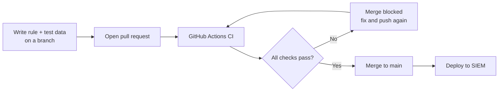
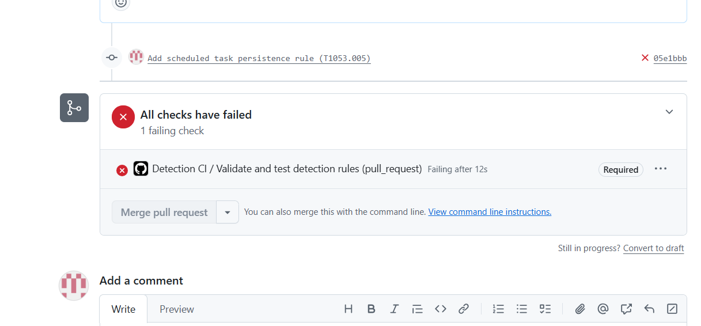
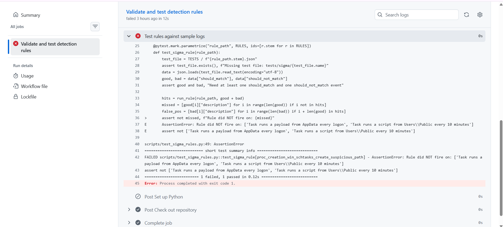
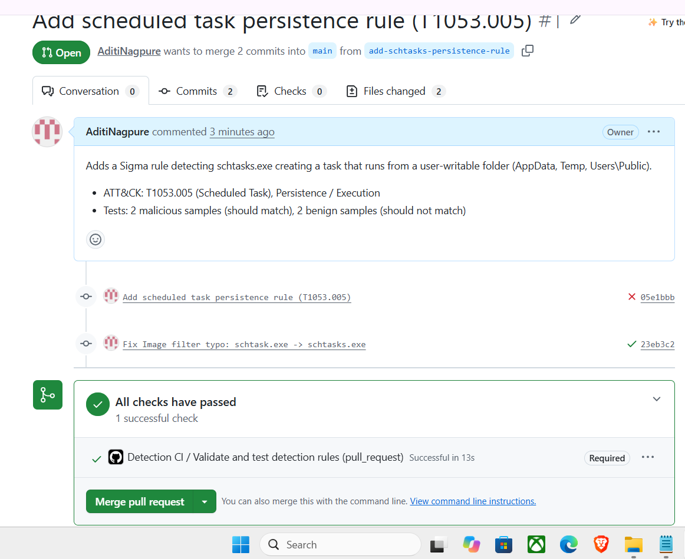
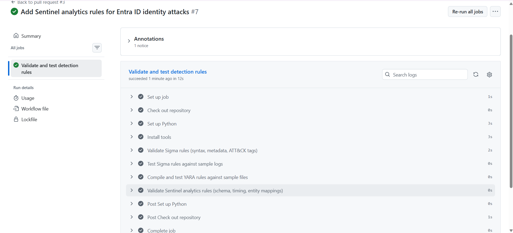

# Detection-as-Code


Detection rules (Sigma, YARA and Microsoft Sentinel) managed like software. Every rule lives in Git, has its own test data, and has to pass an automated CI pipeline before it can be merged into `main`. A rule that is broken, badly tagged or never fires on its malicious samples is blocked at the pull request.

**Author:** Aditi Nagpure

---

## Why this matters

Most detection gaps aren't missing rules. They come from rules that look fine but silently never fire: a typo in a process name, a renamed field, an outdated ATT&CK tag, a query window that skips events. This repo treats each rule as code with tests, so those failures are caught before deployment, not discovered after an incident.

---

## Rules

| Type | Rule | Detects | ATT&CK |
|---|---|---|---|
| Sigma | `proc_creation_win_powershell_encoded_command` | PowerShell launched with a Base64-encoded command | T1059.001, T1027 |
| Sigma | `proc_creation_win_schtasks_create_suspicious_path` | Scheduled task created to run from AppData, Temp or Users\Public | T1053.005 |
| Sigma | `proc_creation_win_rundll32_comsvcs_lsass_dump` | LSASS memory dump via `comsvcs.dll` MiniDump, including the `#24` ordinal evasion | T1003.001 |
| Sigma | `proc_creation_win_shadow_copy_deletion` | Shadow copy deletion with vssadmin or WMIC (a LockBit pre-encryption step) | T1490 |
| Sigma | `proc_creation_win_net_user_add_local_account` | Local account created with `net` / `net1 user /add` | T1136.001 |
| YARA | `ps_download_cradle` | PowerShell script that downloads code and runs it from memory | T1059.001, T1105 |
| YARA | `html_smuggling` | HTML attachment that rebuilds a file from Base64 and forces a download | T1027.006, T1566.001 |
| Sentinel | `entra_password_spray_single_ip` | One IP failing passwords against 5+ Entra ID users in an hour | T1110.003 |
| Sentinel | `entra_mfa_fatigue_repeated_denials` | 3+ MFA failures for one user in an hour (MFA bombing) | T1621 |
| Sentinel | `entra_break_glass_account_signin` | Any sign-in to the emergency break-glass admin account | T1078.004 |

---

## Pipeline



`main` is protected: pull requests are required, the CI check must pass, and admins cannot bypass it.

Each run executes these steps (about 15 seconds in total):

| Step | What it checks |
|---|---|
| Validate Sigma rules | `sigma check --fail-on-issues`: syntax, required metadata, valid ATT&CK tags against current MITRE data |
| Test Sigma rules | Each rule is converted to SQL with pySigma and run against its malicious and benign sample events |
| Compile and test YARA rules | Each rule must compile, match every file in `match/` and ignore every file in `nomatch/` |
| Validate Sentinel rules | Required fields, allowed values, `queryFrequency <= queryPeriod`, technique ID format, duplicate rule IDs, entity-mapping columns exist in the KQL |

Every rule must ship with **at least one sample it should match and one it should not**. A rule with no test data fails CI.

---

## Proof it works

### 1. CI blocks a broken rule

The scheduled-task rule was first submitted with a one-letter typo: `schtask.exe` instead of `schtasks.exe`. The syntax was valid, so `sigma check` passed, but the rule could never fire in production. The tests caught it, and the merge was blocked.





After fixing the typo, the same PR went green and could be merged:



### 2. Full pipeline



### 3. Live deployment to Microsoft Sentinel

The break-glass rule was deployed as a scheduled analytics rule in a Microsoft 365 E5 lab tenant and triggered with a real sign-in.

| Evidence | Screenshot |
|---|---|
| Rule query returns the sign-in in Advanced Hunting | [query result](docs/evidence/sentinel_break_glass_query_result.png), [details](docs/evidence/sentinel_break_glass_query_result_details.png) |
| `ConditionalAccessStatus: notApplied` confirms the account bypasses Conditional Access, which is why every sign-in must alert | [details](docs/evidence/sentinel_break_glass_query_result_details.png) |
| Rule preview against existing data | [preview](docs/evidence/sentinel_break_glass_rule_preview.png) |
| Rule enabled in Sentinel Analytics | [enabled](docs/evidence/sentinel_break_glass_rule_enabled.png) |
| Incident created automatically, with Account and IP entities mapped | [incident](docs/evidence/sentinel_break_glass_incident.png), [list](docs/evidence/sentinel_break_glass_incident_list.png) |

Timeline: sign-in at 18:46 IST, first activity recorded 18:47, incident created 19:00, which matches the rule's 15-minute schedule. The incident was then closed as *Informational, expected activity (security testing)* with a comment explaining the test.

IP addresses are redacted in all screenshots.

---

## Things I learned building this

- **The validator caught real framework drift.** MITRE has split the old Defense Evasion tactic into **Stealth** and **Defense Impairment**. My first Sigma rule used `attack.defense-evasion`, and `sigma check` flagged it as invalid. Microsoft Sentinel's tactic picker still shows Defense Evasion, so the Sentinel validator still accepts it. Different tools update at different speeds, and automated checks are how you notice.
- **Syntax checks are not enough.** The `schtask.exe` typo passed validation. Only a test with real-looking malicious data proved the rule was useless.
- **Default views can hide alerts.** The live High-severity incident was hidden in the Defender portal by a default "Priority score 15-100" filter, because new incidents start with a low score.
- **Evidence needs sanitising before publishing.** Sign-in logs contain real public IPs; these were redacted before committing.

---

## Honest limitations

- **KQL is not executed in CI.** GitHub Actions cannot run KQL, so Sentinel rules are validated structurally in CI and proven live in a Sentinel workspace. Only the break-glass rule has been triggered live; the password-spray and MFA-fatigue rules are CI-validated only.
- **Test data is synthetic.** Sample events and files are hand-written to be realistic (no real malware is stored here), not captured from production telemetry.
- **Deployment to Sentinel is manual.** Rules are copied into Sentinel from the YAML. See the design note for how this would be automated.

---

## Run it locally

```powershell
git clone https://github.com/AditiNagpure/detection-as-code.git
cd detection-as-code
python -m venv .venv
.\.venv\Scripts\Activate.ps1
python -m pip install -r requirements.txt

sigma check --fail-on-issues rules\sigma
python -m pytest scripts -v
```

## Adding a rule

1. Create a branch.
2. Add the rule to `rules/<type>/`.
3. Add test data with the same name:
   - Sigma: `tests/sigma/<rule>.json` with `should_match` and `should_not_match` events
   - YARA: files in `tests/yara/<rule>/match/` and `tests/yara/<rule>/nomatch/`
4. Run the tests locally, push and open a pull request.
5. Merge once CI is green.

## Repository layout

```
rules/
  sigma/        Sigma rules (.yml)
  yara/         YARA rules (.yar)
  sentinel/     Sentinel scheduled analytics rules (.yaml, Azure-Sentinel format)
tests/
  sigma/        JSON sample events per rule
  yara/         match/ and nomatch/ sample files per rule
scripts/        pytest test harnesses for each rule type
docs/
  design-note.md  How this would scale to hundreds of rules
  evidence/       Screenshots of CI runs and the live Sentinel incident
.github/workflows/detection-ci.yml
```

## Design note

[How I would manage detection rules at scale](docs/design-note.md)
